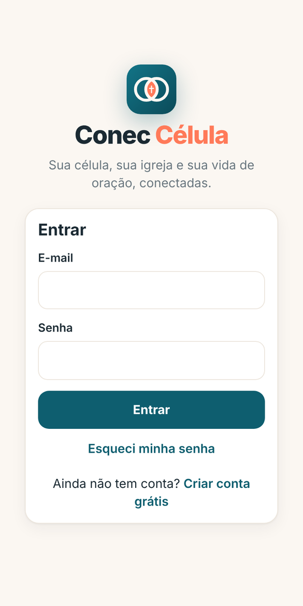
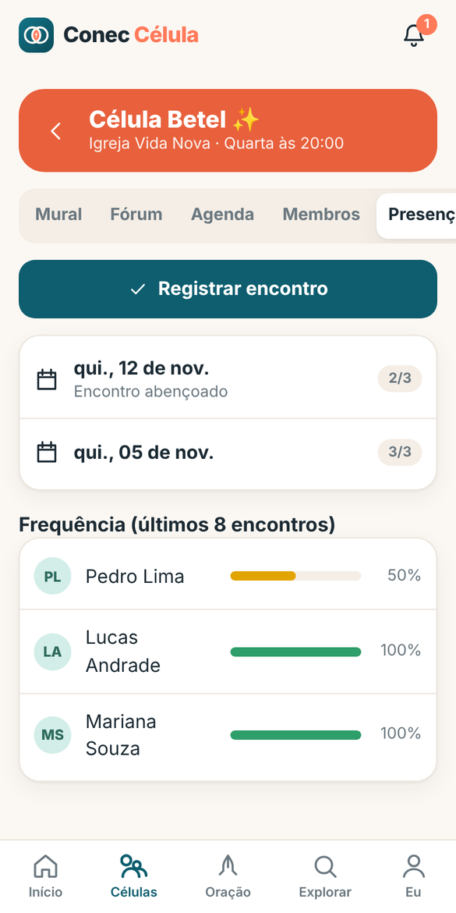
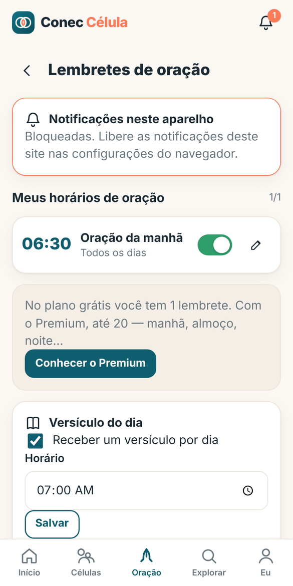
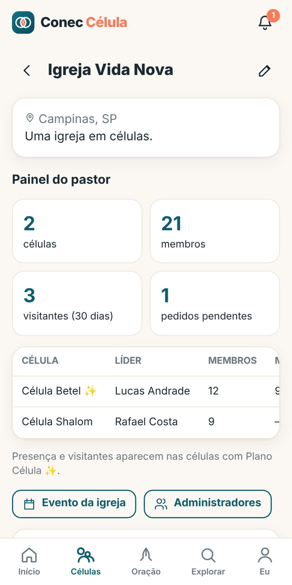
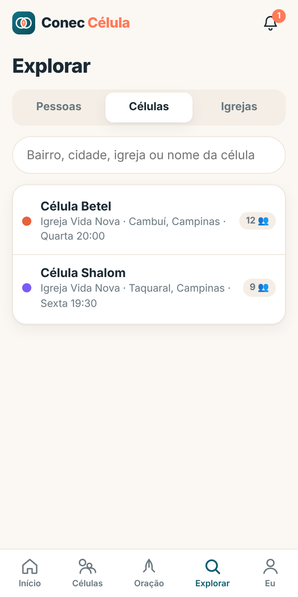

<div align="center">


# Conec Célula

**Sua célula, sua igreja e sua vida de oração, conectadas.**

Aplicativo para igrejas em células, com grupos fechados, rede social cristã, pedidos e lembretes de oração e assinaturas.


</div>

---

## ✨ O que o app faz

### 👥 Células (grupos fechados)
- **Pedido de entrada:** a pessoa encontra a célula e pede para entrar. O líder recebe uma notificação e aprova ou recusa.
- **Mural do líder:** tema do encontro, versículo, dinâmica e avisos. Todos os membros são notificados.
- **Fórum:** discussões abertas por qualquer membro, com comentários.
- **Agenda:** eventos com confirmação (Vou / Talvez / Não vou), aniversariantes do mês e escala (lanche, louvor, palavra, casa…).
- **Presença:** registro de cada encontro, frequência por membro e aviso automático ao líder quando alguém falta duas vezes seguidas.
- **Visitantes:** cadastro e acompanhamento, com atalho para mandar mensagem no WhatsApp.
- **Multiplicação:** cria uma célula nova com outro líder e parte dos membros.
- **Encontrar célula:** busca por bairro, cidade ou igreja, com mapa. O endereço exato só aparece para membros.

### ⛪ Igrejas
- Várias igrejas na mesma plataforma, cada uma com pastor e administradores.
- **Painel do pastor:** células, membros, média de presença, visitantes e pedidos pendentes.
- Eventos da igreja visíveis para todas as células.

### 💬 Rede social
- Publicações com texto, versículo e foto, além de curtidas, comentários e compartilhamento.
- Conexões entre pessoas, com feed "Para você" e "Conexões".
- Denúncia, bloqueio e painel de moderação.

### 🙏 Oração
- **Pedidos de oração** visíveis para todos, só para a célula ou só para os líderes, com o botão *"Orei por você"*.
- **Lembretes de oração** nos horários e dias que a pessoa escolher, enviados por notificação com um versículo.
- **Versículo do dia** no horário que cada um preferir.
- **Diário de oração** privado.
- **Planos de leitura** individuais ou em grupo com a célula.

### 💳 Assinaturas
| | Grátis | ✨ Premium (pessoa) | 👥 Plano Célula (líder) |
|---|:---:|:---:|:---:|
| Células, mural, fórum, rede social, pedidos de oração | ✓ | ✓ | ✓ |
| Versículo do dia | ✓ | ✓ | ✓ |
| Lembretes de oração | 1 | até 20 | — |
| Diário de oração | | ✓ | |
| Planos de leitura | 2 | todos | |
| Membros por célula | até 15 | | ilimitado |
| Presença, faltas, visitantes, escala, multiplicação | | | ✓ |

A cobrança é mensal e recorrente pelo **Mercado Pago**, e a liberação acontece sozinha quando o pagamento é confirmado.

---

## 📱 Telas

| Login | Início | Mural da célula | Membros e pedidos |
|:---:|:---:|:---:|:---:|
|  |  |  |  |
| **Presença** | **Oração** | **Lembretes** | **Painel do pastor** |
|  |  |  |  |
| **Planos** | **Encontrar célula** | | |
|  |  | | |

> As telas acima usam dados fictícios.

---

## 🧱 Tecnologia

| Parte | Ferramenta | Por quê |
|---|---|---|
| App | HTML + CSS + JavaScript puro (módulos ES), PWA | Não precisa de build: o que está em `app/` é o que vai para o ar. Instala na tela do celular. |
| Hospedagem | Vercel (ou qualquer hospedagem estática) | Publica sozinha a cada envio para o GitHub. |
| Banco, login e arquivos | Supabase (PostgreSQL, Auth, Storage) | Segurança por linha (RLS): cada pessoa só acessa o que pode. |
| Servidor | Supabase Edge Functions (Deno) | Notificações push e integração com o Mercado Pago. |
| Agendamentos | `pg_cron` + `pg_net` | Lembretes e versículo do dia a cada minuto; alerta de faltas uma vez por dia. |
| Notificações | Web Push (VAPID) | Implementação própria com WebCrypto, sem dependências. |
| Pagamentos | Mercado Pago (assinaturas / *preapproval*) | Cobrança recorrente no Brasil. |
| Mapa | Leaflet + OpenStreetMap | Gratuito, sem chave de API. |

---

## 🚀 Como colocar no ar

O passo a passo completo, pensado para quem nunca publicou um app, está em **[docs/instalacao.md](docs/instalacao.md)**.

Resumo:

1. Crie um projeto no **Supabase** e rode, no SQL Editor, `supabase/migrations/001_estrutura.sql` e depois `002_dados_iniciais.sql`.
2. Preencha **`app/js/config.js`** com a URL e a chave *anon* do Supabase e a chave pública VAPID (gere em `ferramentas/gerar-chaves-notificacao.html`).
3. Importe este repositório na **Vercel** com *Root Directory* = `app`.
4. Crie as 4 **Edge Functions** (`notificar`, `mp-assinar`, `mp-webhook`, `mp-cancelar`) e cadastre as *Secrets*.
5. Rode `003_agendamentos.sql` para ligar os envios automáticos.
6. Configure o **webhook do Mercado Pago**.
7. Aponte seu **domínio** para a Vercel.

---

## 📂 Estrutura

```
conec-celula/
├── app/                        ← o aplicativo (vai para a Vercel)
│   ├── index.html
│   ├── manifest.webmanifest    ← dados para instalar como app
│   ├── sw.js                   ← service worker: offline + push
│   ├── css/app.css
│   ├── icons/                  ← logo e ícones
│   └── js/
│       ├── config.js           ← ⚙️ ÚNICO arquivo que você edita
│       ├── app.js              ← rotas, layout e sessão
│       ├── sb.js               ← conexão com o Supabase
│       ├── push.js             ← notificações no aparelho
│       ├── ui.js               ← componentes de interface
│       └── views/              ← uma tela por arquivo
├── supabase/
│   ├── migrations/             ← SQL do banco (rodar em ordem)
│   ├── functions/              ← Edge Functions
│   └── config.toml
├── ferramentas/
│   └── gerar-chaves-notificacao.html
└── docs/                       ← documentação
```

---

## 📚 Documentação

| Documento | Conteúdo |
|---|---|
| [Instalação](docs/instalacao.md) | Passo a passo para publicar: Supabase, Vercel, domínio, Mercado Pago |
| [Funcionalidades](docs/funcionalidades.md) | Como cada parte funciona para o pastor, o líder e o membro |
| [Arquitetura](docs/arquitetura.md) | Como as peças se conectam: fluxos de notificação e de pagamento |
| [Banco de dados](docs/banco-de-dados.md) | Tabelas, permissões (RLS) e funções |
| [Personalização](docs/personalizacao.md) | Como mudar nome, cores, preços, limites e textos |

---

## 🔒 Privacidade e segurança

- Toda tabela tem **Row Level Security**, então as permissões são aplicadas pelo próprio banco, não só pela tela.
- Telefone e data de nascimento ficam numa tabela separada, visível só para a própria pessoa e para os líderes dela.
- O aniversário aparece só como dia e mês, e cada pessoa pode ocultar.
- O mapa público mostra a região aproximada da célula (~100 m), e o endereço completo fica só para membros.
- A pessoa pode excluir a própria conta e todos os seus dados (LGPD).
- A chave `service_role` e o token do Mercado Pago ficam **somente** nas Secrets do Supabase, nunca no app.

---

<div align="center">

Feito com 💛 para a igreja em células.

© Conec Célula. Todos os direitos reservados.

</div>
