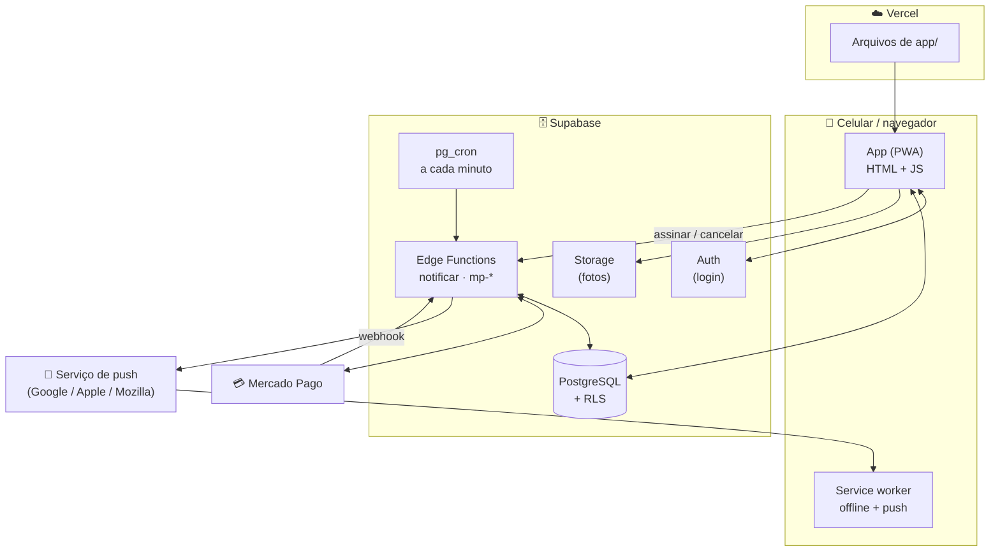
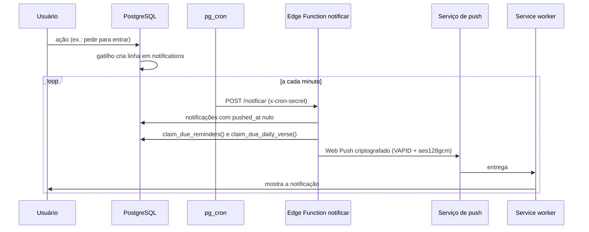
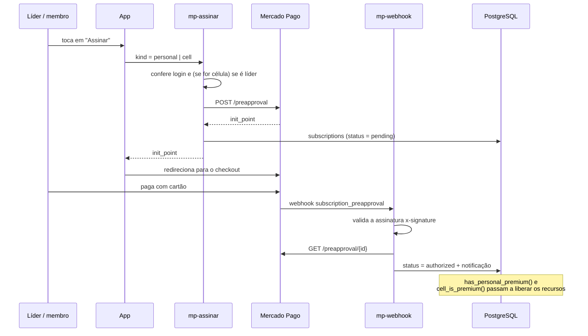

# Arquitetura

## Visão geral

**Por que assim:**
- **Sem servidor próprio.** O app fala direto com o banco, e quem garante a segurança são as regras de **RLS** no PostgreSQL. Só o que precisa de segredo (token do Mercado Pago, chave privada das notificações) roda nas Edge Functions.
- **Sem build.** O código em `app/` é publicado como está. A biblioteca do Supabase vem de CDN pelo `importmap` do `index.html`. Qualquer pessoa consegue editar e publicar.
- **PWA em vez de loja de apps.** Não há taxa nem espera de aprovação, e a atualização é instantânea. Dá para empacotar para as lojas no futuro (ex.: com Capacitor ou PWABuilder).

## O app (`app/`)

| Arquivo | Responsabilidade |
|---|---|
| `js/app.js` | Rotas por hash (`#/celula/123`), layout (topo + barra inferior), proteção de páginas que exigem login, tratamento dos links de e-mail (confirmação e nova senha) |
| `js/sb.js` | Cliente Supabase, estado do usuário (`state.me`, `state.premium`, `state.myCells`), mensagens de erro amigáveis, upload de fotos |
| `js/ui.js` | Mini-biblioteca: `h()` para criar elementos, ícones SVG, toast, janela inferior (sheet), confirmação, formatação de datas, avatar |
| `js/push.js` | Pede permissão, inscreve o aparelho e salva em `push_subscriptions` |
| `js/views/*.js` | Uma tela (ou grupo de telas) por arquivo, carregada só quando é aberta |
| `sw.js` | Cache para abrir offline, recebe o push e abre a tela certa ao tocar na notificação |

Cada tela é uma função `async (params, query) => Element`. Para recarregar a tela atual depois de uma ação, chama-se `refresh()`.

**Segurança no front:** todo texto do usuário entra como `textNode` (nunca `innerHTML`), então não há risco de XSS. Os links nos textos são detectados e abertos com `rel="noopener"`.

## Fluxo de notificações

- As funções `claim_due_*` marcam o envio **na mesma operação** em que selecionam os lembretes. Por isso o mesmo lembrete nunca é enviado duas vezes, mesmo se duas execuções se sobrepuserem.
- A janela de tolerância é de 15 minutos: se o agendamento atrasar, o lembrete ainda sai.
- O horário é calculado no **fuso de cada pessoa** (`profiles.timezone`, preenchido pelo aparelho).
- Quando o aparelho desinstala o app ou revoga a permissão, o serviço de push responde 404/410 e a inscrição é apagada.

## Fluxo de pagamento

- O **external_reference** (`tipo:usuário:célula`) permite reconstruir a assinatura mesmo que o registro local se perca.
- As cobranças mensais seguintes chegam como `subscription_authorized_payment` e atualizam a data da próxima cobrança.
- Pausa e cancelamento pelo Mercado Pago também chegam pelo webhook e bloqueiam os recursos na hora.
- Os recursos pagos são bloqueados **no banco** (RLS e gatilhos), não só na tela.

## Privacidade (LGPD) no desenho

| Dado | Onde fica | Quem vê |
|---|---|---|
| Nome, foto, bio, cidade | `profiles` | Usuários logados |
| Telefone, nascimento | `profiles_private` | A pessoa e os líderes das células dela |
| Aniversário (dia/mês) | via `cell_birthdays()` | Membros da mesma célula, se a pessoa permitir |
| Endereço da célula | `cell_private` | Membros aprovados |
| Localização no mapa | `cells.lat/lng` (arredondado ~100 m) | Todos |
| Diário de oração | `prayer_journal` | Só a pessoa |
| Pedido de oração | `prayer_requests` | Conforme a visibilidade escolhida |

Excluir a conta (`delete_my_account()`) apaga o usuário, e tudo o que é dele é removido em cascata.
