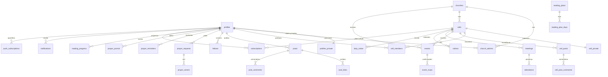

# Banco de dados

O banco é criado pelos arquivos de `supabase/migrations/`, que devem ser rodados em ordem:

| Arquivo | O que faz |
|---|---|
| `001_estrutura.sql` | Tabelas, funções, gatilhos, regras de segurança (RLS) e bucket de fotos |
| `002_dados_iniciais.sql` | 60 versículos do dia e 5 planos de leitura |
| `003_agendamentos.sql` | Agendamentos do `pg_cron` (troque `SEU-PROJETO` e `SEU-SEGREDO` antes) |

## Diagrama



## Tabelas

### Pessoas
| Tabela | Descrição |
|---|---|
| `profiles` | Perfil público e preferências (fuso, horário do versículo do dia). Criado sozinho no cadastro. |
| `profiles_private` | Telefone, data de nascimento e se o aniversário aparece. |
| `follows` | Conexões (quem segue quem). |
| `blocks` | Bloqueios. |

### Igrejas e células
| Tabela | Descrição |
|---|---|
| `churches` | Igrejas. Quem cria vira pastor (gatilho). |
| `church_admins` | Pastores e administradores. |
| `cells` | Células: dia e hora, bairro, cor, posição aproximada, se aparece na busca, célula-mãe (multiplicação). |
| `cell_private` | Endereço completo (só membros). |
| `cell_members` | Participação: `role` (leader, co_leader, host, member) e `status` (pending, approved, rejected, removed). |
| `cell_posts` | Mural (`tema`, `versiculo`, `dinamica`, `aviso`) e fórum (`discussao`). |
| `cell_post_comments` | Comentários do mural e do fórum. |
| `events` / `event_rsvps` | Eventos da célula ou da igreja, com confirmações. |
| `duty_roster` | Escala. ✨ |
| `meetings` / `attendance` | Encontros e presença. ✨ |
| `visitors` | Visitantes. ✨ |

### Rede social e oração
| Tabela | Descrição |
|---|---|
| `posts`, `post_likes`, `post_comments` | Feed. |
| `prayer_requests`, `prayer_amens` | Pedidos de oração e "orei por você". |
| `prayer_journal` | Diário privado (Premium). |
| `prayer_reminders` | Horários de oração de cada pessoa. |
| `reports` | Denúncias. |

### Conteúdo, notificações e pagamentos
| Tabela | Descrição |
|---|---|
| `daily_verses` | Versículos do dia (acrescente quantos quiser). |
| `reading_plans`, `reading_plan_days`, `reading_progress`, `cell_reading_plans` | Planos de leitura. |
| `notifications` | Notificações do app (o sino). `pushed_at` indica se já foi enviada por push. |
| `push_subscriptions` | Aparelhos inscritos para receber push. |
| `subscriptions` | Assinaturas: `kind` (personal/cell), `provider` (mercadopago/manual), `status`. |

✨ = só grava com o Plano Célula ativo.

## Funções principais

### De permissão (usadas pelo RLS)
| Função | Retorna verdadeiro quando… |
|---|---|
| `is_cell_member(célula)` | O usuário é membro aprovado |
| `is_cell_leader(célula)` | O usuário é líder/co-líder ou admin da igreja da célula |
| `is_church_admin(igreja)` | O usuário é pastor/admin |
| `leads_user(pessoa)` | O usuário lidera alguma célula da pessoa |
| `has_personal_premium()` | O usuário tem Premium ativo |
| `cell_is_premium(célula)` | A célula tem Plano Célula ativo |
| `is_platform_admin()` | O usuário é admin da plataforma |

### Chamadas pelo app (RPC)
| Função | Uso |
|---|---|
| `find_cells(busca)` | Lista pública de células para "Encontrar célula" |
| `cell_birthdays(célula)` | Aniversariantes (dia/mês) |
| `church_stats(igreja)` | Números do painel do pastor |
| `set_cell_role(célula, pessoa, papel)` | Mudar a função de um membro |
| `multiply_cell(célula, nome, novo_líder, membros)` | Multiplicar célula |
| `verse_of_the_day()` | Versículo do dia |
| `delete_my_account()` | Excluir a conta (LGPD) |

### Internas (só o servidor chama)
| Função | Uso |
|---|---|
| `claim_due_reminders()` | Pega e marca os lembretes de oração que chegaram na hora |
| `claim_due_daily_verse()` | Pega e marca quem deve receber o versículo agora |
| `check_absences()` | Avisa os líderes sobre faltas (diário) |
| `notify(...)` | Cria uma notificação |
| `plan_limit(chave)` | Limites do plano grátis |

## Gatilhos

| Gatilho | Efeito |
|---|---|
| Novo usuário em `auth.users` | Cria `profiles` e `profiles_private` |
| Nova igreja | Criador vira pastor |
| Nova célula | Criador vira líder; cria `cell_private` |
| Aprovar membro | Bloqueia acima de 15 membros sem Plano Célula |
| Novo lembrete | Bloqueia acima do limite do plano |
| Pedido de entrada / aprovação | Notifica líderes / membro |
| Publicação no mural, evento | Notifica membros |
| Curtida, comentário, conexão, "orei" | Notifica o autor |

## Consultas úteis

```sql
-- Quantos usuários, igrejas e células
select (select count(*) from profiles) usuarios,
       (select count(*) from churches) igrejas,
       (select count(*) from cells where status = 'active') celulas;

-- Assinaturas ativas e receita mensal
select kind, count(*), sum(amount) receita
from subscriptions where status = 'authorized' group by kind;

-- Acrescentar um versículo do dia
insert into daily_verses (ref, text) values ('Salmos 46:10', 'Aquietai-vos, e sabei que eu sou Deus.');
```
