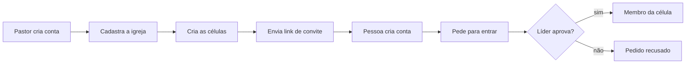

# Funcionalidades

Como o Conec Célula funciona para cada tipo de pessoa.

## Papéis

| Papel | Quem é | O que pode fazer |
|---|---|---|
| **Membro** | Qualquer pessoa aprovada numa célula | Ver o mural, abrir discussões no fórum, confirmar presença em eventos, ver aniversariantes, fazer pedidos de oração para a célula |
| **Anfitrião** | Membro que recebe o encontro em casa | O mesmo que o membro; o papel aparece na lista |
| **Co-líder** | Ajudante do líder | Tudo o que o líder faz, menos nomear outro líder |
| **Líder** | Responsável pela célula | Aprovar entradas, publicar no mural, criar eventos e escala, registrar presença e visitantes, mudar funções, multiplicar, assinar o Plano Célula |
| **Pastor / admin da igreja** | Quem cadastrou a igreja ou foi adicionado | Criar células, ver o painel com todas as células, agir como líder em qualquer célula da igreja, criar eventos da igreja |
| **Admin da plataforma** | Você, dono do app | Ver e resolver denúncias em *Eu → Moderação* |

## Primeiro uso

1. **Pastor:** cria a conta e vai em *Células → Cadastrar igreja*.
2. Na página da igreja, toca em **Nova célula**. Quem cria a célula vira o líder dela.
3. Para passar a liderança, a pessoa precisa primeiro entrar na célula. Depois, em *Membros*, toque em ⋯ ao lado do nome → **Tornar líder**.
4. **Convite:** em *Membros → Convidar*, mande o link pelo WhatsApp. Quem abre o link cria a conta e pede para entrar.

## Célula

| Aba | O que tem | Quem vê |
|---|---|---|
| **Mural** | Tema, versículo, dinâmica e avisos (com data do encontro e opção de fixar), mais o endereço do encontro | Membros |
| **Fórum** | Discussões abertas por qualquer membro, com respostas | Membros |
| **Agenda** | Eventos com confirmação, aniversariantes do mês e do próximo, escala e plano de leitura em grupo | Membros |
| **Membros** | Pedidos de entrada (para o líder), lista com funções, convite, multiplicação e botão para sair | Membros |
| **Presença** ✨ | Registro dos encontros e frequência dos últimos 8 | Líderes |
| **Visitantes** ✨ | Quem visitou, contato, atalho para o WhatsApp e marcação de "já contatado" | Líderes |
| **Ajustes** | Dados da célula, endereço, posição no mapa e plano | Líderes |

✨ = recurso do **Plano Célula**.

**Antes de entrar**, a pessoa vê só o nome, a igreja, o dia e horário, o bairro e quantos membros a célula tem. O endereço, o mural e as conversas só aparecem depois da aprovação.

**Limite do plano grátis:** 15 membros por célula. Ao tentar aprovar o 16º, o app avisa e sugere o Plano Célula.

## Notificações automáticas

| Quando | Quem recebe |
|---|---|
| Alguém pede para entrar | Líderes da célula |
| O pedido é aprovado | A pessoa |
| O líder publica no mural | Todos os membros |
| Um evento é criado na célula | Todos os membros |
| Um membro falta a 2 encontros seguidos ✨ | Líderes (uma vez por dia, às 10h) |
| Alguém curte, comenta ou se conecta | O autor ou a pessoa |
| Alguém toca em "Orei por você" | Quem fez o pedido |
| A assinatura é aprovada | Quem assinou |
| Lembrete de oração | A pessoa, no horário que ela escolheu |
| Versículo do dia | A pessoa, no horário que ela escolheu |

Todas aparecem no sino 🔔 do app e, se a pessoa ativou, também como notificação no celular.

## Oração

- **Pedidos:** a pessoa escolhe quem vê: todos, a célula ou só os líderes. Os outros tocam em **🙏 Orar por isso**, e quem pediu é avisado. Depois dá para marcar o pedido como **respondido** e contar o testemunho.
- **Lembretes:** horário, nome (ex.: "Oração da manhã") e dias da semana. A notificação chega com o versículo do dia. O grátis permite 1 lembrete e o Premium até 20.
- **Versículo do dia:** o mesmo para todos no dia, enviado no horário que cada um escolher (padrão 7h). Há 60 versículos cadastrados, e você pode adicionar mais.
- **Diário** (Premium): anotações privadas que só a própria pessoa vê.

## Rede social

- **Feed "Para você":** as publicações mais recentes de todos.
- **Feed "Conexões":** só de quem você segue.
- Publicação com texto, referência bíblica opcional e foto (redimensionada no aparelho antes de enviar).
- O versículo do dia pode ser compartilhado com um toque.
- **Segurança:** denunciar publicação, comentário, pedido ou perfil, e bloquear uma pessoa. Quando há bloqueio, um deixa de ver as publicações do outro.

## Planos de leitura

| Plano | Plano do app |
|---|---|
| João em 21 dias | Grátis |
| Atos em 28 dias | Grátis |
| Provérbios em 31 dias | Premium |
| Salmos em 50 dias | Premium |
| Novo Testamento em 260 dias | Premium |

O líder pode escolher um plano para a célula inteira, e ele aparece na *Agenda*. O líder também vê o progresso de cada membro.

## Painel do pastor

Em *Células → (sua igreja)*:
- Totais: células, membros, visitantes nos últimos 30 dias e pedidos pendentes.
- Tabela por célula: líder, membros, média de presença (60 dias), visitantes e data do último encontro.
- Criar eventos da igreja e gerenciar os administradores.

## Assinaturas

- **Premium (pessoal):** a pessoa assina para si mesma.
- **Plano Célula:** o líder assina e o plano vale para a célula toda.
- O pagamento é feito no Mercado Pago (cartão de crédito, cobrança mensal). O app libera o plano sozinho quando o Mercado Pago confirma.
- O cancelamento é feito em *Eu → Planos e assinatura → Cancelar*.
- Você pode dar planos de **cortesia** pelo SQL (veja a [instalação](instalacao.md#passo-9-tornar-se-administrador-da-plataforma)).

## Instalar no celular

O app é um **PWA**: abre pelo navegador e pode ser instalado na tela inicial, sem loja de aplicativos.
- **Android:** Chrome → *Instalar app*.
- **iPhone:** Safari → Compartilhar → *Adicionar à Tela de Início*. No iPhone, as notificações só funcionam quando o app é aberto pelo ícone (iOS 16.4 ou mais novo).
